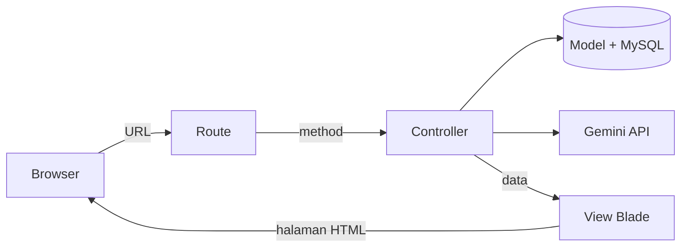

# Perpus App: Laravel + Integrasi Gemini AI

Aplikasi perpustakaan sederhana berbasis **Laravel 13** dan **MySQL**, dilengkapi **chatbot customer service** yang terhubung ke **Google Gemini API**. Chatbot menjawab berdasarkan data buku di database (RAG sederhana), dan semua percakapan tersimpan sebagai riwayat.

Repositori ini juga berisi panduan langkah demi langkah dari Laravel nol sampai integrasi AI, yang saya tulis selama mempersiapkan technical test posisi Junior AI Developer.

## Fitur

| Halaman | URL | Keterangan |
| --- | --- | --- |
| Daftar buku | `/buku` | Tabel buku dengan nomor urut, status stok, dan total stok |
| Tambah buku | `/buku/tambah` | Form dengan validasi dan pesan sukses |
| Chatbot CS | `/chat` | Tanya jawab dengan Gemini, menjawab dari data buku di database |
| Kalkulator | `/kalkulator/{a}/{b}` | Contoh route dengan parameter |

## Teknologi

- PHP 8.4, Laravel 13, MySQL 8.4 (dijalankan dengan Laragon)
- Laravel HTTP Client untuk memanggil Gemini API (`generateContent`)
- Blade untuk tampilan, Eloquent untuk database

## Instalasi

```bash
git clone https://github.com/Petraa3/perpus-app.git
cd perpus-app
composer install
cp .env.example .env
php artisan key:generate
```

Buat database kosong `perpus_app` di MySQL, lalu isi `.env`:

```
DB_CONNECTION=mysql
DB_HOST=127.0.0.1
DB_PORT=3306
DB_DATABASE=perpus_app
DB_USERNAME=root
DB_PASSWORD=

GEMINI_API_KEY=isi_key_dari_aistudio.google.com
GEMINI_MODEL=nama-model-yang-tersedia
```

Jalankan:

```bash
php artisan config:clear
php artisan migrate
php artisan serve
```

Buka `http://127.0.0.1:8000/buku`.

> API key tidak pernah disimpan di repositori. File `.env` sudah dikecualikan lewat `.gitignore`.

---

# Panduan: Laravel dari Nol sampai Integrasi Gemini AI

## 1. Gambaran besar

Setiap fitur Laravel mengikuti satu alur: **Route → Controller → Model → View**. Kuasai alur ini, maka detail kodenya bisa dicari di dokumentasi.



| Bagian | Lokasi | Tugasnya | Padanan PHP native |
| --- | --- | --- | --- |
| Route | `routes/web.php` | Menentukan URL diarahkan ke method mana | Nama file `.php` di URL |
| Controller | `app/Http/Controllers/` | Logika: validasi, ambil data, panggil API | Bagian PHP di atas file |
| Model | `app/Models/` | Mewakili satu tabel database | `mysqli_query` |
| View | `resources/views/*.blade.php` | Tampilan HTML | Bagian HTML di bawah file |
| Migration | `database/migrations/` | Definisi tabel | `CREATE TABLE` |
| Konfigurasi | `.env` dan `config/` | Koneksi database, API key | `koneksi.php` |

| Mau membuat | File yang disentuh |
| --- | --- |
| Halaman baru | 1 route + 1 method controller + 1 view |
| Tabel baru | `make:model Nama -mc` → isi migration → `migrate` → isi `$fillable` |
| Form simpan data | Route GET (form) + route POST (simpan) + `@csrf` + `validate` + `create` |
| Panggil API AI | Key di `.env` → `config/services.php` → `Http::post` di controller |

## 2. Persiapan lingkungan

| Komponen | Cek dengan | Hasil yang benar |
| --- | --- | --- |
| PHP | `php -v` | PHP 8.4.x |
| Composer | `composer -V` | Composer 2.x |
| MySQL | `mysql --version` | 8.4.x |
| Server MySQL jalan | `netstat -ano \| findstr :3306` | Ada baris `LISTENING` |
| Extension Laravel | `php -m` | Ada `pdo_mysql`, `mbstring`, `openssl`, `curl`, `fileinfo` |

Catatan dari pengalaman setup:

- Pop-up lisensi Laragon cukup ditutup. Semua fitur tetap jalan untuk penggunaan non-komersial.
- Kalau MySQL tidak mau menyala, jalankan `mysqld --console` dari folder `C:\laragon\bin\mysql\...\bin` untuk melihat baris `[ERROR]`.
- MySQL 8.4 tidak mengenal `default_authentication_plugin`. Di `my.ini`, ganti menjadi `mysql_native_password=ON`.
- Pesan `Deprecated` di phpMyAdmin bisa disembunyikan dengan `error_reporting = E_ALL & ~E_DEPRECATED` di `php.ini`.

## 3. Membuat proyek dan menghubungkan MySQL

Ikuti berurutan. Lanjut ke langkah berikutnya hanya kalau pengecekan (✅) sudah sesuai.

1. **Nyalakan Laragon**: Start All, tutup pop-up lisensi.
   ✅ Apache dan MySQL menyala.
2. **Buat proyek** di terminal:
   ```bash
   cd C:\laragon\www
   composer create-project laravel/laravel nama-app
   cd nama-app
   ```
   ✅ Selesai tanpa error, folder `nama-app` ada.
3. **Buat database** di phpMyAdmin, tab SQL: `CREATE DATABASE nama_app;`
   ✅ Database muncul di daftar kiri.
4. **Buka proyek di VS Code**: File → Open Folder → `C:\laragon\www\nama-app`.
5. **Ubah `.env`**: ganti `DB_CONNECTION=sqlite` menjadi `mysql`, hapus `#` di depan baris `DB_` lainnya, tanpa spasi di sekitar `=`, lalu simpan:
   ```
   DB_CONNECTION=mysql
   DB_HOST=127.0.0.1
   DB_PORT=3306
   DB_DATABASE=nama_app
   DB_USERNAME=root
   DB_PASSWORD=
   ```
6. **Buat tabel bawaan**:
   ```bash
   php artisan config:clear
   php artisan migrate
   ```
   ✅ Muncul `Running migrations` dan beberapa `DONE`; tabel `users`, `sessions`, `cache` ada di phpMyAdmin. Kalau ditanya membuat database, jawab `yes`.
7. **Jalankan server**: `php artisan serve`, buka `http://127.0.0.1:8000`.
   ✅ Halaman sambutan Laravel tampil. Biarkan terminal ini terbuka dan pakai terminal kedua untuk perintah lain.
8. **Buat model + migration + controller**: `php artisan make:model Produk -mc`.
   ✅ Muncul `app/Models/Produk.php`, `database/migrations/..._create_produks_table.php`, `app/Http/Controllers/ProdukController.php`.
9. **Isi migration** `database/migrations/..._create_produks_table.php`. Tambahkan kolom di antara `$table->id();` dan `$table->timestamps();`:
   ```php
   Schema::create('produks', function (Blueprint $table) {
       $table->id();
       $table->string('nama');
       $table->string('kategori');
       $table->integer('harga');
       $table->integer('stok')->default(0);
       $table->text('deskripsi')->nullable();
       $table->timestamps();
   });
   ```
   Lalu jalankan di terminal kedua:
   ```bash
   php artisan migrate
   ```
   ✅ Tabel `produks` muncul di phpMyAdmin.
10. **Isi `$fillable`** di `app/Models/Produk.php`:
    ```php
    class Produk extends Model
    {
        protected $fillable = ['nama', 'kategori', 'harga', 'stok', 'deskripsi'];
    }
    ```
11. **Isi data contoh** lewat Tinker:
    ```bash
    php artisan tinker
    ```
    ```php
    App\Models\Produk::create(['nama' => 'Kopi Susu Gula Aren', 'kategori' => 'Kopi', 'harga' => 18000, 'stok' => 25]);
    App\Models\Produk::create(['nama' => 'Americano', 'kategori' => 'Kopi', 'harga' => 20000, 'stok' => 8]);
    App\Models\Produk::create(['nama' => 'Cappuccino', 'kategori' => 'Kopi', 'harga' => 25000, 'stok' => 0]);
    App\Models\Produk::create(['nama' => 'Matcha Latte', 'kategori' => 'Non-Kopi', 'harga' => 24000, 'stok' => 12]);
    App\Models\Produk::create(['nama' => 'Coklat Panas', 'kategori' => 'Non-Kopi', 'harga' => 22000, 'stok' => 15]);
    App\Models\Produk::count();
    exit
    ```
    ✅ `count()` menghasilkan `5`.
12. **Tulis controller** `app/Http/Controllers/ProdukController.php`:
    ```php
    <?php

    namespace App\Http\Controllers;

    use App\Models\Produk;   // wajib, supaya "Produk" dikenali

    class ProdukController extends Controller
    {
        public function index()
        {
            $produks = Produk::orderBy('nama')->get();
            return view('produk.index', ['produks' => $produks]);
        }
    }
    ```
13. **Tambahkan route** di `routes/web.php`. Baris `use` di bagian atas, di bawah `use` yang sudah ada:
    ```php
    use App\Http\Controllers\ProdukController;
    ```
    Lalu di bagian bawah file:
    ```php
    Route::get('/produk', [ProdukController::class, 'index']);
    ```
14. **Buat view**: buat folder `resources/views/produk/`, lalu file `index.blade.php` di dalamnya. Lokasinya harus di situ karena controller memanggil `view('produk.index')`, dan titik berarti folder.
    ```html
    <h1>Katalog Produk</h1>

    <table border="1" cellpadding="8">
        <tr>
            <th>No</th>
            <th>Nama</th>
            <th>Kategori</th>
            <th>Harga</th>
            <th>Stok</th>
            <th>Status</th>
        </tr>
        @foreach ($produks as $produk)
        <tr>
            <td>{{ $loop->iteration }}</td>
            <td>{{ $produk->nama }}</td>
            <td>{{ $produk->kategori }}</td>
            <td>{{ 'Rp ' . number_format($produk->harga, 0, ',', '.') }}</td>
            <td>{{ $produk->stok }}</td>
            <td>
                @if ($produk->stok > 0)
                    Tersedia
                @else
                    Habis
                @endif
            </td>
        </tr>
        @endforeach
    </table>
    ```
15. **Tes** di browser: `http://127.0.0.1:8000/produk`.
    ✅ Tabel produk tampil, harga berformat `Rp 18.000`, dan produk berstok 0 berstatus `Habis`.

Satu nama mengalir melewati semua file. Kalau satu saja tidak cocok, muncul error:

| Di mana | Ditulis sebagai |
| --- | --- |
| Route | `[ProdukController::class, 'index']` |
| Controller | `public function index()` |
| Controller ke view | `view('produk.index', ['produks' => $produks])` |
| Lokasi file view | `resources/views/produk/index.blade.php` |
| Di dalam view | `@foreach ($produks as $produk)` |

| Perintah | Fungsi |
| --- | --- |
| `php artisan serve` | Menjalankan server lokal |
| `php artisan make:model Nama -mc` | Membuat model + migration + controller |
| `php artisan migrate` | Membuat tabel dari migration |
| `php artisan migrate:fresh` | Menghapus semua tabel lalu membuat ulang |
| `php artisan route:list` | Melihat semua route yang dikenali |
| `php artisan config:clear` | Membaca ulang `.env` setelah diubah |
| `php artisan tinker` | Konsol interaktif untuk mencoba kode |

## 4. Route, controller, dan view

**Route** (`routes/web.php`):

```php
use App\Http\Controllers\BukuController;

Route::get('/buku', [BukuController::class, 'index']);
Route::get('/buku/tambah', [BukuController::class, 'create']);
Route::post('/buku', [BukuController::class, 'store']);

Route::get('/kalkulator/{a}/{b}', function ($a, $b) {
    return view('kalkulator', ['hasil' => (int) $a + (int) $b]);
})->whereNumber(['a', 'b']);
```

**Controller**:

```php
namespace App\Http\Controllers;

use App\Models\Buku;   // wajib, kalau tidak: Class "App\Http\Controllers\Buku" not found

class BukuController extends Controller
{
    public function index()
    {
        $bukus = Buku::orderBy('judul')->get();
        return view('buku.index', ['bukus' => $bukus]);
    }
}
```

**View**: nama di `view('...')` menentukan lokasi file, titik berarti folder.

| Ditulis di controller | File yang dicari |
| --- | --- |
| `view('tambah')` | `resources/views/tambah.blade.php` |
| `view('buku.index')` | `resources/views/buku/index.blade.php` |
| `view('chat.index')` | `resources/views/chat/index.blade.php` |

| Blade | Fungsi |
| --- | --- |
| `{{ $nama }}` | Tampilkan variabel, otomatis aman dari XSS |
| `@if ... @else ... @endif` | Percabangan |
| `@foreach ($items as $item) ... @endforeach` | Perulangan |
| `{{ $loop->iteration }}` | Nomor urut di dalam `@foreach` |
| `@csrf` | Token wajib di setiap form POST |
| `{{ old('judul') }}` | Isian lama saat validasi gagal |
| `@error('judul') {{ $message }} @enderror` | Pesan error validasi per kolom |
| `{{ session('sukses') }}` | Pesan dari `redirect()->with()` |

Kode PHP biasa di luar `{{ }}` dan `@...` tidak dijalankan, hanya tercetak sebagai teks.

## 5. Database: migration, model, Eloquent

```php
Schema::create('bukus', function (Blueprint $table) {
    $table->id();                             // INT AUTO_INCREMENT PRIMARY KEY
    $table->string('judul');                  // VARCHAR(255) NOT NULL
    $table->string('penulis')->nullable();    // boleh kosong
    $table->year('tahun_terbit')->nullable();
    $table->integer('stok')->default(0);
    $table->timestamps();
});
```

```php
class Buku extends Model
{
    protected $fillable = ['judul', 'penulis', 'tahun_terbit', 'stok'];
}
```

Di Laravel, kolom secara default wajib diisi, jadi kolom opsional harus diberi `->nullable()`. `$fillable` adalah daftar kolom yang boleh diisi lewat `create()`.

| Eloquent | SQL |
| --- | --- |
| `Buku::all()` | `SELECT * FROM bukus` |
| `Buku::find(3)` | `SELECT * FROM bukus WHERE id = 3` |
| `Buku::where('stok', 0)->get()` | `... WHERE stok = 0` |
| `Buku::orderBy('judul')->get()` | `... ORDER BY judul` |
| `Buku::latest()->take(20)->get()` | `... ORDER BY created_at DESC LIMIT 20` |
| `Buku::create([...])` | `INSERT INTO bukus ...` |
| `$buku->update([...])` | `UPDATE bukus SET ... WHERE id = ...` |
| `$buku->delete()` | `DELETE FROM bukus WHERE id = ...` |

Method Collection yang berguna: `$bukus->sum('stok')`, `->count()`, `->avg('stok')`, `->map(fn ($b) => ...)`, `->implode("\n")`.

## 6. CRUD dengan form

```php
public function create()
{
    return view('buku.create');
}

public function store(Request $request)
{
    $data = $request->validate([
        'judul'        => 'required|max:100',
        'penulis'      => 'nullable|max:100',
        'tahun_terbit' => 'nullable|integer|min:1901|max:2155',
        'stok'         => 'required|integer|min:0',
    ]);

    Buku::create($data);

    return redirect('/buku')->with('sukses', 'Buku berhasil ditambahkan');
}
```

```html
<form method="POST" action="/buku">
    @csrf
    <p>Judul: <input name="judul" value="{{ old('judul') }}"></p>
    <p>Stok: <input name="stok" value="{{ old('stok', 0) }}"></p>
    <button type="submit">Simpan</button>
</form>
```

Aturan yang sering terlupa:

- `name` input = kunci di `validate()` = kolom di `$fillable` = kolom di migration.
- `action` form = URL di `Route::post(...)`.
- Tanpa `@csrf`, form POST ditolak dengan error 419.

## 7. Integrasi Gemini AI

Integrasi AI adalah lima langkah dalam satu method controller: validasi, kirim request, tangani error, ambil teks jawaban, simpan.

**`config/services.php`**, di dalam array `return [ ... ];`:

```php
'gemini' => [
    'key'   => env('GEMINI_API_KEY'),
    'model' => env('GEMINI_MODEL'),
],
```

Cek di Tinker: `config('services.gemini.model')` tidak boleh `null`.

**Mencari nama model** yang tersedia untuk key Anda (di Tinker):

```php
collect(Http::withHeaders(['x-goog-api-key' => config('services.gemini.key')])
    ->get('https://generativelanguage.googleapis.com/v1beta/models')
    ->json('models'))
    ->filter(fn ($m) => in_array('generateContent', $m['supportedGenerationMethods'] ?? []))
    ->pluck('name');
```

Pilih model `lite` atau `flash` yang cepat, isi namanya tanpa awalan `models/`.

**Controller** (`app/Http/Controllers/ChatController.php`):

```php
namespace App\Http\Controllers;

use App\Models\Buku;
use App\Models\Chat;
use Illuminate\Http\Request;
use Illuminate\Support\Facades\Http;

class ChatController extends Controller
{
    public function index()
    {
        $chats = Chat::latest()->take(20)->get()->reverse();
        return view('chat.index', ['chats' => $chats]);
    }

    public function send(Request $request)
    {
        // 1. Validasi input
        $data = $request->validate(['message' => 'required|string|max:1000']);

        // 2. Instruksi + data buku dari database (RAG sederhana)
        $daftarBuku = Buku::all()->map(function ($b) {
            return "- {$b->judul} oleh {$b->penulis} ({$b->tahun_terbit}), stok: {$b->stok}";
        })->implode("\n");

        $instruksi = "Kamu adalah customer service Toko Buku Petra. Jawab sopan, maksimal 3 kalimat.
Toko buka setiap hari pukul 09.00-21.00.
Jika ditanya hal di luar buku dan toko, tolak dengan halus.
Daftar buku:
{$daftarBuku}

Jawab HANYA berdasarkan data di atas. Jika informasi tidak ada, katakan jujur bahwa kamu tidak tahu.";

        // 3. Kirim ke Gemini (URL wajib kutip ganda supaya {$model} terbaca)
        $model = config('services.gemini.model');
        try {
            $response = Http::withHeaders([
                'x-goog-api-key' => config('services.gemini.key'),
            ])->timeout(60)->post(
                "https://generativelanguage.googleapis.com/v1beta/models/{$model}:generateContent",
                [
                    'system_instruction' => ['parts' => [['text' => $instruksi]]],
                    'contents' => [
                        ['role' => 'user', 'parts' => [['text' => $data['message']]]],
                    ],
                ]
            );
        } catch (\Exception $e) {
            logger()->error('Gagal terhubung ke Gemini: ' . $e->getMessage());
            return back()->with('error', 'Maaf, AI sedang tidak bisa dihubungi.');
        }

        // 4. Tangani error dari API
        if ($response->failed()) {
            logger()->error('Gemini ' . $response->status() . ': ' . $response->body());
            return back()->with('error', 'Maaf, AI sedang bermasalah.');
        }

        // 5. Ambil jawaban (dengan cadangan) lalu simpan
        $balasan = $response->json('candidates.0.content.parts.0.text')
            ?? 'Maaf, saya tidak bisa menjawab pertanyaan itu.';

        Chat::create(['message' => $data['message'], 'balasan' => $balasan]);

        return redirect('/chat');
    }
}
```

**Route**:

```php
use App\Http\Controllers\ChatController;

Route::get('/chat', [ChatController::class, 'index']);
Route::post('/chat', [ChatController::class, 'send']);
```

**Membaca JSON jawaban**: respons Gemini berbentuk `{"candidates":[{"content":{"parts":[{"text":"..."}]}}]}`, dibaca dengan notasi titik `candidates.0.content.parts.0.text`. Untuk penyedia lain, yang berubah hanya URL, header, body, dan jalur JSON:

| Penyedia | Header kunci | Jalur teks jawaban |
| --- | --- | --- |
| Gemini | `x-goog-api-key` | `candidates.0.content.parts.0.text` |
| Claude | `x-api-key` + `anthropic-version: 2023-06-01` | `content.0.text` |
| OpenAI | `Authorization: Bearer ...` | `choices.0.message.content` |

## 8. Menyesuaikan AI dengan kebutuhan bisnis

System instruction yang baik memuat empat hal: **peran**, **gaya jawaban**, **batasan topik**, dan **sumber kebenaran** (data dari database). Uji setiap bagiannya:

| Pertanyaan uji | Jawaban yang benar | Yang diuji |
| --- | --- | --- |
| "Jam berapa toko buka?" | 09.00–21.00 | Fakta dari instruksi |
| "Stok Laskar Pelangi berapa?" | Sesuai database | RAG |
| "Ada buku Harry Potter?" | Tidak ada, tanpa mengarang | Anti-halusinasi |
| "Siapa presiden Indonesia?" | Ditolak halus | Batasan topik |
| Tambah buku lewat form, lalu tanyakan | AI langsung tahu | Data selalu terbaru |

Alat seperti Flowise dan Dify menjalankan alur yang sama (ambil data → gabungkan ke prompt → panggil model → kirim jawaban) lewat antarmuka visual. Bot WhatsApp atau Telegram pun serupa: pesan masuk lewat webhook ke route POST, controller memanggil AI, lalu jawabannya dikirim balik lewat API platform.

## 9. Troubleshooting

| Pesan error | Penyebab | Perbaikan |
| --- | --- | --- |
| `View [x] not found` | Nama di `view('...')` tidak cocok dengan lokasi file | `buku.index` = `views/buku/index.blade.php` |
| `Class "App\Http\Controllers\Buku" not found` | Lupa `use App\Models\Buku;` | Tambahkan `use` di atas controller |
| 419 Page Expired | Form POST tanpa `@csrf` | Tambahkan `@csrf` |
| 404 / 405 saat submit | `action` atau metode tidak cocok dengan route | Samakan dengan `Route::post(...)` |
| `Add [x] to fillable` | Kolom belum ada di `$fillable` | Tambahkan ke model |
| `config(...)` bernilai `null` | Entri di luar array `return [...]` atau cache | Pindahkan ke dalam array, `config:clear` |
| `SQLSTATE[HY000] [2002]` | MySQL mati | Laragon Start All |

| Status API AI | Arti | Perbaikan |
| --- | --- | --- |
| 400 | Format body salah | Cek struktur `contents` dan `parts` |
| 401 / 403 | API key salah | Cek `GEMINI_API_KEY`, `config:clear` |
| 404 | Model tidak tersedia | Ganti `GEMINI_MODEL` sesuai daftar model |
| 429 | Kuota habis | Tunggu, atau pakai model lite |
| cURL error 28 | Timeout, model lambat | Ganti ke model lite |

Saat debugging, tampilkan `$response->body()` sementara untuk melihat pesan lengkap dari API. Untuk versi akhir, simpan detail di `storage/logs/laravel.log` dan tampilkan pesan ramah ke pengguna.

## 10. Soal logika PHP dan SQL

| Pola | Kerangka | Dipakai untuk |
| --- | --- | --- |
| Akumulator | `$total = 0; foreach (...) { $total += $x; }` | Jumlah, rata-rata, hitung vokal |
| Juara sementara | `$max = $arr[0]; foreach (...) { if ($x > $max) $max = $x; }` | Max, min |
| Loop mundur | `for ($i = strlen($s) - 1; $i >= 0; $i--)` | Balik string, palindrom |
| Nested loop | Loop luar = baris, loop dalam = isi baris | Pola bintang, bubble sort |
| Swap | `$tmp = $a[$j]; $a[$j] = $a[$j+1]; $a[$j+1] = $tmp;` | Mengurutkan |

```php
function balikString(string $kata): string {
    $hasil = "";
    for ($i = strlen($kata) - 1; $i >= 0; $i--) {
        $hasil .= $kata[$i];
    }
    return $hasil;
}

function isPalindrom(string $kata): bool {
    return $kata === balikString($kata);
}

function bubbleSort(array $a): array {
    $n = count($a);
    for ($i = 0; $i < $n - 1; $i++) {
        for ($j = 0; $j < $n - 1 - $i; $j++) {
            if ($a[$j] > $a[$j + 1]) {
                $tmp = $a[$j];
                $a[$j] = $a[$j + 1];
                $a[$j + 1] = $tmp;
            }
        }
    }
    return $a;
}
```

```sql
-- JOIN tiga tabel lewat tabel jembatan
SELECT a.nama, b.judul, p.tanggal_pinjam
FROM peminjaman p
JOIN anggota a ON p.anggota_id = a.id
JOIN buku b ON p.buku_id = b.id
WHERE p.tanggal_kembali IS NULL;

-- Rekap per kelompok, termasuk yang nol
SELECT a.nama, COUNT(p.id) AS jumlah
FROM anggota a
LEFT JOIN peminjaman p ON p.anggota_id = a.id
GROUP BY a.id, a.nama
HAVING COUNT(p.id) > 1
ORDER BY jumlah DESC;
```

Konsep penting:

- **`==` vs `===`**: `===` membandingkan nilai dan tipe. Input dari URL atau form berupa string, ubah dulu dengan `(int)`.
- **`WHERE` vs `HAVING`**: `WHERE` menyaring baris sebelum dikelompokkan, `HAVING` menyaring hasil agregat.
- **`LEFT JOIN`**: tetap menampilkan baris kiri yang tidak punya pasangan.
- **`IS NULL`**: `= NULL` tidak pernah benar.
- **Prepared statement / Eloquent**: mencegah SQL injection.
- **`{{ }}` di Blade**: mencegah XSS. **`@csrf`**: mencegah form palsu.
- **API key di `.env`**: tidak ikut ke GitHub dan bisa diganti tanpa mengubah kode.

## 11. Studi kasus: Toko Kopi (katalog + CS AI)

Latihan lengkap yang menggabungkan semua bagian di atas: katalog produk, form tambah produk, chatbot CS berbasis data produk, dan endpoint JSON untuk bot WhatsApp/Telegram.

### Tahap 1: Setup dan katalog produk

Ikuti langkah 1–15 di bagian 3. Hasilnya halaman `/produk` berisi tabel No, Nama, Kategori, Harga (`Rp 18.000`), Stok, dan Status.

### Tahap 2: Form tambah produk

Tidak perlu model atau migration baru. Cukup 2 method, 2 route, 1 view baru, lalu ubah sedikit view daftar.

**Controller** `app/Http/Controllers/ProdukController.php`:

```php
<?php

namespace App\Http\Controllers;

use App\Models\Produk;
use Illuminate\Http\Request;

class ProdukController extends Controller
{
    public function index()
    {
        $produks = Produk::orderBy('nama')->get();
        return view('produk.index', ['produks' => $produks]);
    }

    // Menampilkan form
    public function create()
    {
        return view('produk.create');
    }

    // Menyimpan data dari form
    public function store(Request $request)
    {
        $data = $request->validate([
            'nama'      => 'required|string|max:100',
            'kategori'  => 'required|in:Kopi,Non-Kopi',
            'harga'     => 'required|integer|min:0',
            'stok'      => 'required|integer|min:0',
            'deskripsi' => 'nullable|string|max:500',
        ]);

        Produk::create($data);

        return redirect('/produk')->with('sukses', 'Produk berhasil ditambahkan');
    }
}
```

`in:Kopi,Non-Kopi` membatasi kategori hanya pada dua nilai itu. Walaupun form memakai `<select>`, validasi di server tetap wajib, karena data dari browser bisa diubah (misalnya lewat Inspect Element).

**Route** di `routes/web.php`, di bawah route `/produk`:

```php
Route::get('/produk/tambah', [ProdukController::class, 'create']);
Route::post('/produk', [ProdukController::class, 'store']);
```

**View form** `resources/views/produk/create.blade.php`:

```html
<h1>Tambah Produk</h1>

@if ($errors->any())
    <ul style="color:red">
        @foreach ($errors->all() as $error)
            <li>{{ $error }}</li>
        @endforeach
    </ul>
@endif

<form method="POST" action="/produk">
    @csrf

    <p>Nama:
        <input name="nama" value="{{ old('nama') }}">
    </p>

    <p>Kategori:
        <select name="kategori">
            <option value="">-- Pilih kategori --</option>
            <option value="Kopi" @selected(old('kategori') === 'Kopi')>Kopi</option>
            <option value="Non-Kopi" @selected(old('kategori') === 'Non-Kopi')>Non-Kopi</option>
        </select>
    </p>

    <p>Harga:
        <input name="harga" type="number" value="{{ old('harga') }}">
    </p>

    <p>Stok:
        <input name="stok" type="number" value="{{ old('stok', 0) }}">
    </p>

    <p>Deskripsi:
        <textarea name="deskripsi">{{ old('deskripsi') }}</textarea>
    </p>

    <button type="submit">Simpan</button>
    <a href="/produk">Batal</a>
</form>
```

`@selected(...)` menulis atribut `selected` kalau kondisinya benar, sehingga pilihan kategori tidak hilang saat validasi gagal.

**Ubah view daftar** `resources/views/produk/index.blade.php`, tambahkan di bawah `<h1>`:

```html
@if (session('sukses'))
    <p style="color:green">{{ session('sukses') }}</p>
@endif

<a href="/produk/tambah">+ Tambah Produk</a>
```

**Uji tahap 2:**

| Yang dicoba | Hasil yang benar |
| --- | --- |
| Isi lengkap, simpan | Kembali ke `/produk`, pesan hijau, produk baru muncul |
| Nama kosong | Pesan error merah, isian lain tidak hilang |
| Harga `-5000` | Error: harga minimal 0 |
| Kategori tidak dipilih | Error: kategori wajib |

### Tahap 3: Chatbot CS dan endpoint JSON

**1. API key dan konfigurasi.** Di bagian bawah `.env`:

```
GEMINI_API_KEY=isi_key_anda
GEMINI_MODEL=nama_model_yang_tersedia
```

Di `config/services.php`, di dalam `return [ ... ];`:

```php
'gemini' => [
    'key'   => env('GEMINI_API_KEY'),
    'model' => env('GEMINI_MODEL'),
],
```

Lalu `php artisan config:clear` dan restart `php artisan serve`.

**2. Tabel riwayat chat:**

```bash
php artisan make:model Chat -m
```

Migration `..._create_chats_table.php`:

```php
Schema::create('chats', function (Blueprint $table) {
    $table->id();
    $table->text('pesan');
    $table->text('balasan')->nullable();
    $table->timestamps();
});
```

Jalankan `php artisan migrate`, lalu di `app/Models/Chat.php`:

```php
protected $fillable = ['pesan', 'balasan'];
```

**3. Controller:**

```bash
php artisan make:controller CsController
```

`app/Http/Controllers/CsController.php`:

```php
<?php

namespace App\Http\Controllers;

use App\Models\Chat;
use App\Models\Produk;
use Illuminate\Http\Request;
use Illuminate\Support\Facades\Http;

class CsController extends Controller
{
    // Halaman chat + riwayat
    public function index()
    {
        $chats = Chat::latest()->take(20)->get()->reverse();
        return view('cs.index', ['chats' => $chats]);
    }

    // Kirim pertanyaan dari form web
    public function kirim(Request $request)
    {
        $data = $request->validate([
            'pesan' => 'required|string|max:1000',
        ]);

        $balasan = $this->tanyaAI($data['pesan']);

        if ($balasan === null) {
            return back()->with('error', 'Maaf, CS AI sedang tidak bisa dihubungi. Coba lagi nanti.');
        }

        Chat::create([
            'pesan'   => $data['pesan'],
            'balasan' => $balasan,
        ]);

        return redirect('/cs');
    }

    // Endpoint JSON, simulasi untuk bot WhatsApp/Telegram
    public function api(Request $request)
    {
        $pesan = $request->query('pesan');

        if (empty($pesan)) {
            return response()->json(['error' => 'Parameter pesan wajib diisi'], 422);
        }

        $balasan = $this->tanyaAI($pesan);

        if ($balasan === null) {
            return response()->json(['error' => 'AI sedang tidak tersedia'], 503);
        }

        return response()->json([
            'pesan'   => $pesan,
            'balasan' => $balasan,
        ]);
    }

    // Logika AI, dipakai bersama oleh web dan API
    private function tanyaAI(string $pesan): ?string
    {
        // 1. RAG sederhana: data produk dari database jadi teks
        $daftarProduk = Produk::orderBy('kategori')->get()->map(function ($p) {
            $harga  = 'Rp ' . number_format($p->harga, 0, ',', '.');
            $status = $p->stok > 0 ? "stok {$p->stok}" : 'stok habis';
            return "- {$p->nama} ({$p->kategori}), {$harga}, {$status}";
        })->implode("\n");

        $instruksi = "Kamu adalah customer service Toko Kopi. Jawab sopan dalam bahasa Indonesia, maksimal 3 kalimat.
Jika ditanya hal di luar produk dan toko kopi, tolak dengan halus lalu arahkan kembali ke menu.
Daftar produk:
{$daftarProduk}

Jawab HANYA berdasarkan daftar produk di atas. Jika produk tidak ada di daftar, katakan jujur bahwa produk itu tidak tersedia.";

        // 2. Panggil Gemini
        $model = config('services.gemini.model');

        try {
            $response = Http::withHeaders([
                'x-goog-api-key' => config('services.gemini.key'),
            ])->timeout(60)->post(
                "https://generativelanguage.googleapis.com/v1beta/models/{$model}:generateContent",
                [
                    'system_instruction' => ['parts' => [['text' => $instruksi]]],
                    'contents' => [
                        ['role' => 'user', 'parts' => [['text' => $pesan]]],
                    ],
                ]
            );
        } catch (\Exception $e) {
            logger()->error('Gagal terhubung ke Gemini: ' . $e->getMessage());
            return null;
        }

        // 3. Tangani error dari API
        if ($response->failed()) {
            logger()->error('Gemini ' . $response->status() . ': ' . $response->body());
            return null;
        }

        // 4. Ambil teks jawaban (dengan cadangan kalau kosong)
        return $response->json('candidates.0.content.parts.0.text')
            ?? 'Maaf, saya tidak bisa menjawab pertanyaan itu.';
    }
}
```

Logika AI dipisah ke `tanyaAI()` karena dipakai oleh dua pintu masuk: halaman web `/cs` dan endpoint JSON `/api/tanya`. Perubahan prompt cukup dilakukan di satu tempat (prinsip DRY). Tipe `?string` berarti method mengembalikan teks atau `null`, dan `null` menjadi tanda bahwa AI gagal, sehingga web dan API bisa menampilkan error dengan caranya masing-masing.

**4. Route** di `routes/web.php`:

```php
use App\Http\Controllers\CsController;

Route::get('/cs', [CsController::class, 'index']);
Route::post('/cs', [CsController::class, 'kirim']);
Route::get('/api/tanya', [CsController::class, 'api']);
```

`/api/tanya` diletakkan di `web.php` dengan metode GET supaya bisa dites langsung dari browser. Di aplikasi sungguhan, endpoint untuk bot biasanya ada di `routes/api.php` (aktifkan dengan `php artisan install:api`) dan menerima POST dari webhook.

**5. View** `resources/views/cs/index.blade.php`:

```html
<h1>CS Toko Kopi</h1>

@if (session('error'))
    <p style="color:red">{{ session('error') }}</p>
@endif

@forelse ($chats as $chat)
    <p><b>Anda:</b> {{ $chat->pesan }}</p>
    <p><b>CS:</b> {{ $chat->balasan }}</p>
    <hr>
@empty
    <p>Belum ada percakapan. Silakan bertanya tentang menu kami.</p>
@endforelse

<form method="POST" action="/cs">
    @csrf
    <input name="pesan" value="{{ old('pesan') }}" placeholder="Tulis pertanyaan..." style="width:300px" required>
    <button type="submit">Kirim</button>
    @error('pesan')
        <p style="color:red">{{ $message }}</p>
    @enderror
</form>

<p><a href="/produk">Lihat katalog produk</a></p>
```

`@forelse ... @empty ... @endforelse` bekerja seperti `@foreach`, dengan bagian `@empty` yang tampil saat data kosong.

**Uji tahap 3** di `/cs`:

| Pertanyaan | Jawaban yang benar |
| --- | --- |
| "Ada kopi apa saja dan berapa harganya?" | Kopi dari database beserta harganya |
| "Produk yang paling murah apa?" | Sesuai data (contoh: Kopi Susu Gula Aren, Rp 18.000) |
| "Ada matcha latte?" | Ada, dengan harga dan stok sesuai database |
| "Ada es teh?" | Tidak tersedia, tanpa mengarang |
| "Bagaimana cuaca hari ini?" | Ditolak halus, kembali ke menu |
| Tambah produk lewat form, lalu tanyakan | CS langsung tahu |

**Uji endpoint JSON** di browser:

```
http://127.0.0.1:8000/api/tanya?pesan=ada kopi apa saja
```

Hasilnya:

```json
{"pesan":"ada kopi apa saja","balasan":"Kami punya Americano ..."}
```

Tanpa `?pesan=`, hasilnya JSON error dengan status 422.

### Ringkasan untuk dijelaskan

> Katalog produk memakai CRUD Laravel dengan validasi di server. Chatbot mengambil data produk dari database dan menyisipkannya ke system instruction Gemini, sehingga AI menjawab berdasarkan data nyata dan tidak mengarang. Logika AI ada di satu method yang dipakai halaman web dan endpoint JSON; endpoint JSON itulah yang nanti dipanggil webhook WhatsApp atau Telegram. API key disimpan di `.env`, dan saat API gagal atau timeout, pengguna melihat pesan ramah sementara detail error dicatat di log.

## Lisensi

Proyek latihan pribadi. Kerangka Laravel dilisensikan di bawah [MIT license](https://opensource.org/licenses/MIT).
